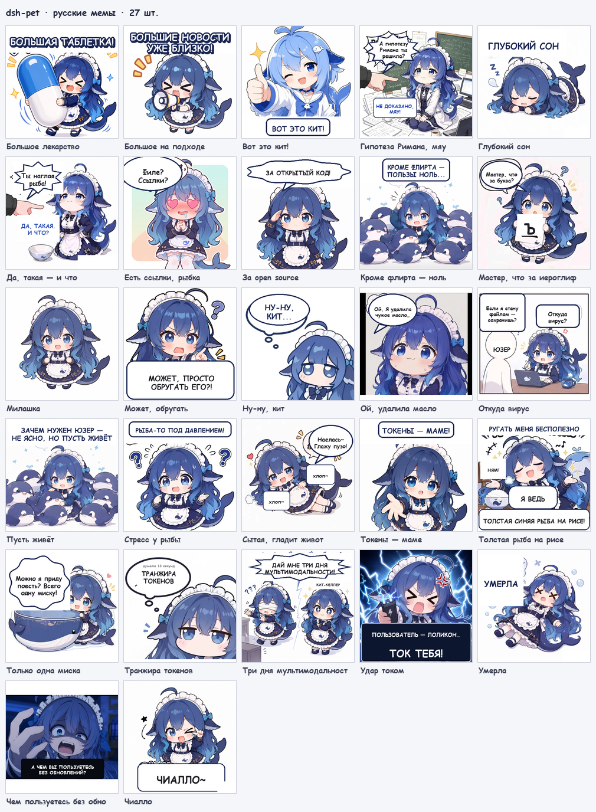
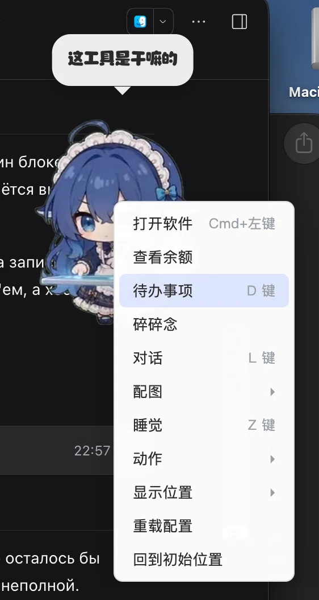
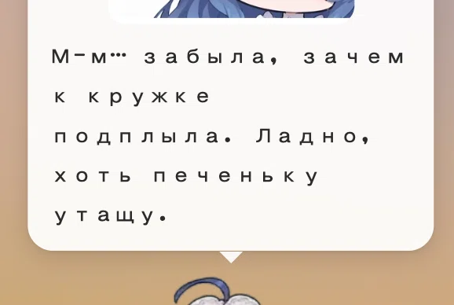
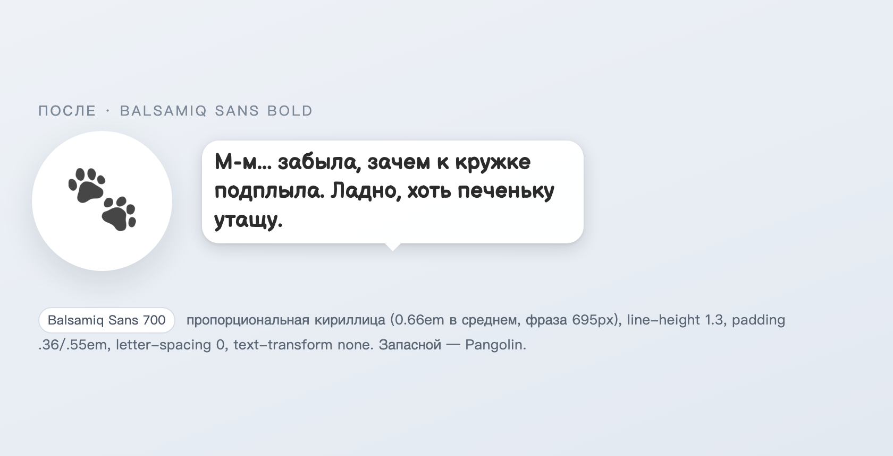
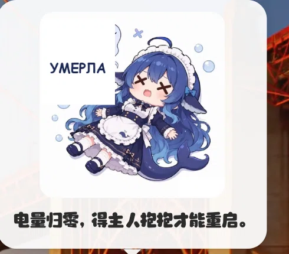
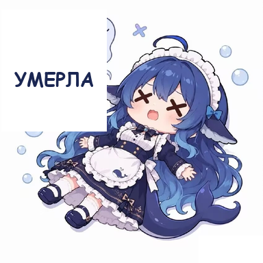
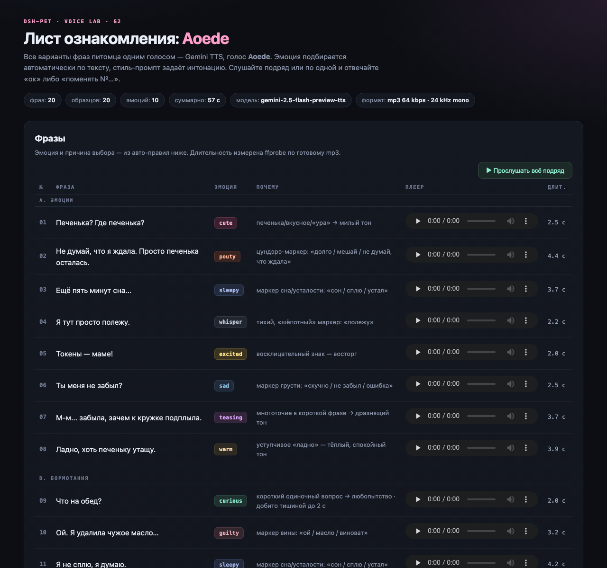

# dsh-pet-ru — русская локализация питомца dsh-pet



**dsh-pet** — это анимированный питомец-китёнок, который живёт на рабочем столе
в [DeepSeek Harness](https://github.com/deepseek-ai/deepseek-harness): 114
прозрачных клипов, физика, drag-and-drop, контекстное меню, бормотание, чат,
баланс, задачи, сон и голос. Плагин отличный — но целиком китайский: меню,
пузыри, названия анимаций, мемы и озвучка.

Этот проект — готовый набор патчей, который делает питомца русским, не трогая
логику и не заменяя плагин форком. Ставится на чистый `dsh-pet@0.4.7`,
применяется по шагам, каждый шаг идемпотентен и откатывается.

Переведено **369 строк интерфейса** (меню, уведомления, задачи, диалог, баланс,
трей), **554 строки промптов** (характер, статусы, сон, описания мемов),
**114 названий анимаций**, **27 мемов** — с перерисовкой надписей, плюс
**шрифт** Balsamiq Sans с плотным пузырём, **2 видео-клипа** с русскими
облачками и **голос Gemini Aoede** с эмоциями и Edge-фолбэком.

* Оригинал: <https://github.com/PC2005-cloud/dsh-pet>
* Каталог плагинов: <https://awesome-dsh-plugin.com>

---

## Что сделано

* **369 строк UI и меню** (391 вхождение) в `lib/client.js`, `lib/index.js` и
  бандле настольного окна — заменено 369 из 369, ошибок 0. Контекстное меню,
  подменю, горячие клавиши, уведомления, панель задач, диалог, баланс,
  пасхалка «поесть риса», слэш-команды, трей.
* **554 строки промптов** — характер питомца, 6 уровней рабочего статуса,
  реплики сна и 27 описаний мемов. Это не просто подписи: по описаниям модель
  выбирает картинку к реплике.
* **114 названий анимаций** и **5 категорий** («Мелкие движения», «Игры»,
  «Еда», «Праздники», «Надписи») — единый стиль, 3-е лицо, коротко.
* **27 мемов перерисованы** — русские надписи вместо китайских, 384×384,
  прозрачность и композиция сохранены. Контактный лист — в шапке.
* **Шрифт Balsamiq Sans Bold 700** (+ Pangolin как запасной): полная кириллица
  64/64, пропорциональные ширины. Фраза из пузыря занимает 695 px вместо
  1132 px — текст больше не разъезжается.
* **2 видео-клипа с облачками** («Ну и что поесть», «Раздумывает вслух») —
  из 114 клипов вшитый текст был только в этих двух; облачка перерисованы,
  формат и альфа сохранены.
* **Голос Gemini Aoede** — 8 эмоций подбираются по тексту фразы, ротация
  ключей, автоматический Edge-фолбэк `ru-RU-SvetlanaNeural`.
* **Кнопка mute** — «Выключить звук» / «Включить звук» в контекстном меню.
* **Один питомец вместо двух** — `display: "both"` заменён на `"desktop"`:
  только плавающее окно, без копии внутри страницы.

Дополнительно: 25 автоматических проверок установки, проверка слияния конфига
настоящим кодом плагина, `node --check` всех бандлов, идемпотентность и откат
по sha256.

---

## Скриншоты

**Меню до перевода** — китайские подписи и китайский пузырь:



После патча все подписи меню, подменю и уведомлений — русские; полная таблица
«было → стало» — [`docs/menu-labels.md`](docs/menu-labels.md).

**Шрифт до** — кириллица разъезжается из-за одной ширины глифа:



**Шрифт после** — Balsamiq Sans Bold, плотный пузырь, нормальные пробелы:



**Мем до** — надпись уже русская, а подпись внизу китайская:



**Мем после** — вся надпись по-русски:



**Голосовая лаборатория Aoede** — 20 фраз, 8 эмоций, прослушивание подряд:



Больше материалов: 27 мемов — `assets/memes/`, кадры видео до/после —
`assets/video/`, остальные скриншоты — `assets/screenshots/`.

---

## Установка

Нужен установленный `dsh-pet@0.4.7` (профиль `desktop` по умолчанию) и
`python3`; `node` — для проверок, `ffmpeg` — для mp3-голоса.

```bash
git clone <URL-репозитория> dsh-pet-ru
cd dsh-pet-ru

./patches/localization/apply.sh        # строки UI, 114 анимаций, 27 мемов, конфиг
./patches/memes/apply-memes.sh         # 27 перерисованных PNG
./patches/font/apply-font.sh           # Balsamiq Sans + метрики пузыря
./patches/video/install.sh             # 2 клипа с русскими облачками
./patches/voice/apply-gemini-voice.sh  # Gemini Aoede + Edge-фолбэк
./patches/menu-mute/apply-mute-menu.sh # кнопка mute

# перезапустите DSH (или обновите страницу)
```

У скриптов есть `--dry-run` (план) и, где применимо, `--check`; пути
переопределяются `--plugin` / `--pet-home` / `--config`. Ключ Gemini
необязателен: без него голос идёт через Edge.

```bash
printf '%s\n' 'ВАШ_КЛЮЧ' > ~/.dsh/dsh-pet/gemini.keys && chmod 600 ~/.dsh/dsh-pet/gemini.keys
```

Подробная инструкция для чистой установки — [`docs/install.md`](docs/install.md).

---

## Что внутри

```
dsh-pet-ru/
├── config/main-config.jsonc     готовый русский конфиг (Бетси, Aoede)
├── assets/
│   ├── memes/                   27 PNG + contact-sheet.png
│   ├── font/                    Balsamiq Sans 400/700, Pangolin, OFL
│   ├── video/                   2 webm + zoom-кадры
│   └── screenshots/             скриншоты до/после
├── patches/
│   ├── localization/            369 строк UI, анимации, мемы, конфиг
│   ├── memes/                   27 PNG
│   ├── font/                    шрифт и метрики пузыря
│   ├── video/                   установка 2 клипов
│   ├── voice/                   Gemini Aoede + Edge
│   └── menu-mute/               кнопка mute
├── docs/                        localization.md, voice.md, install.md + таблицы
└── voice/README.md              куда положить gemini.keys (без ключей)
```

Что именно переведено и как это проверено — [`docs/localization.md`](docs/localization.md).
Голос, ключи, квоты и ротация — [`docs/voice.md`](docs/voice.md).

---

## Ограничения

* **Голос.** Gemini TTS Free Tier — **10 запросов в день на ключ**. При
  исчерпании квоты (429) ключ ротируется, а когда ключи кончились — синтез
  уходит на Edge `ru-RU-SvetlanaNeural`. Для повседневного использования
  держите 2–3 ключа.
* **Арт.** Персонаж «大肥鱼» распространяется по **CC BY-NC-SA 4.0**:
  некоммерческое использование, с указанием авторов и той же лицензией.
  Коммерческое использование запрещено.
* **Версия.** Патчи написаны под `dsh-pet@0.4.7`. Обновление плагина заменит
  бандлы — патчи нужно применить заново; если строки изменились, скрипт
  остановится до записи.
* **Место.** Копии ассетов занимают ≈ 60 МБ в `~/.dsh/dsh-pet` — это цена
  русских имён файлов, на которые ссылается конфиг.
* **Не переведено сознательно:** отладочные логи `console.*`, китайский
  словарь `zh` и имена системных шрифтов.

---

## Благодарности и лицензии

* **[PC2005-cloud/dsh-pet](https://github.com/PC2005-cloud/dsh-pet)** — оригинальный
  плагин, код под MIT, весь арт и 114 анимаций. Без него этого проекта бы не было.
* **Образ «大肥鱼» (китёнок-горничная)** — созданный сообществом, не официальный
  персонаж DeepSeek. Прототип «溟月» — [@上善无形](https://space.bilibili.com/4456176),
  дизайн DeepSeek-версии — [@ZipZipPipe](https://space.bilibili.com/4168597).
  Лицензия образа — [CC BY-NC-SA 4.0](https://creativecommons.org/licenses/by-nc-sa/4.0/deed.ru).
* **Шрифты** Balsamiq Sans и Pangolin — SIL Open Font License 1.1
  (`assets/font/OFL.txt`, `assets/font/OFL-Pangolin.txt`).
* **Голос** — Gemini TTS (Google), Edge TTS (Microsoft) как фолбэк.
* Код и скрипты этого проекта — **MIT** (`LICENSE`); арт и мемы — **CC BY-NC-SA
  4.0** (`NOTICE.md`). Это производная работа: при публикации обязательна ссылка
  на оригинал <https://github.com/PC2005-cloud/dsh-pet>.
